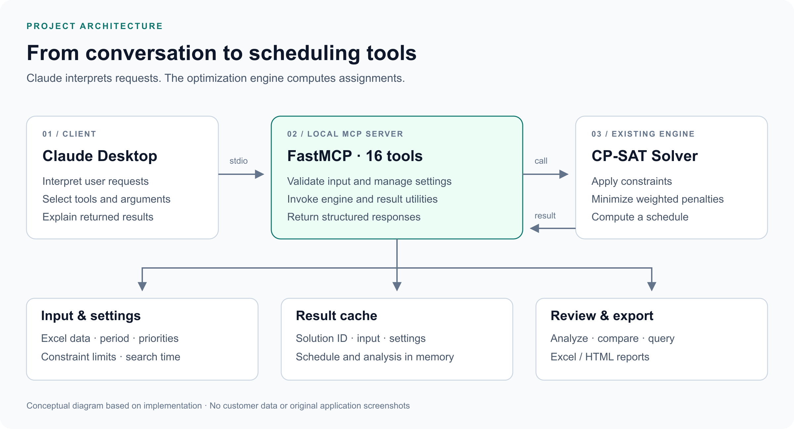

# Claude 기반 간호사 스케줄링 데모

**전문 최적화 엔진을 대화로 활용할 수 있도록 연결한 MCP 프로젝트**

간호사 근무표 생성에 필요한 입력 검증, 설정 변경, 결과 분석을 MCP 도구로 제공했습니다. 사용자는 Claude와의 대화로 생성 조건을 조정하고, 근무표를 생성한 뒤 결과를 비교하거나 파일로 출력할 수 있습니다.

| 구분 | 내용 |
|---|---|
| 프로젝트 맥락 | Omelet 인턴십 중 수행한 간호사 스케줄링 PoC |
| 담당 업무 | 초기 MCP 연동, 설정 처리, 결과 비교 및 데이터 질의 기능 구현·개선 |
| 이 페이지의 범위 | 기존 최적화 엔진과 Claude를 연결한 MCP 데모 |
| 주요 기술 | Python · FastMCP · MCP · Pydantic · pandas · Google OR-Tools CP-SAT |
| 결과물 | 설정 → 생성 → 분석 → 재생성·비교 → 출력으로 이어지는 로컬 데모 |

> 이 저장소는 프로젝트 소개를 위한 문서입니다. 회사 소스코드와 실제 고객 데이터는 포함하지 않습니다. 구조도는 구현 내용을 바탕으로 새로 작성했으며, 사용 시나리오는 실제 대화 기록을 재현한 것이 아닙니다.

## 해결하려던 문제

근무표를 자동 생성하는 모델이 있어도, 현업 사용자가 직접 코드와 설정값을 다루기에는 사용 장벽이 있었습니다. 생성 기간과 규칙의 중요도를 변경하고, 결과를 확인한 뒤 다시 계산하는 작업을 하나의 사용 흐름으로 연결하고자 했습니다.

이를 위해 기존 최적화 엔진을 MCP 도구로 제공했습니다. 사용자의 요청은 Claude가 해석하고, 실제 근무 배정은 제약조건을 반영한 최적화 엔진이 계산하도록 역할을 나눴습니다.

## 시스템 구성

| 구성 | 담당 역할 |
|---|---|
| **Claude / MCP 클라이언트** | 사용자 요청 해석, 도구 선택과 인자 전달, 반환 결과 설명 |
| **FastMCP 서버** | 입력 검증·설정 관리·엔진 호출·결과 활용 기능을 도구로 제공 |
| **기존 최적화 엔진** | 필수 조건과 선호 조건을 반영한 근무표 계산 |
| **결과 관리·출력** | 결과 ID와 설정 보관, 분석·비교, Excel·HTML 출력 |

Claude Desktop과의 연결은 stdio 기반이며, 서버가 Claude API를 직접 호출하는 구조는 아닙니다.

## 제가 맡은 일

### 1. 초기 MCP 연결과 핵심 도구 구현

기존 엔진을 호출할 수 있도록 초기 FastMCP 서버와 입력 검증·근무표 생성·요약 기능을 구현했습니다. 가중치와 제약 기준을 생성 도구에 전달하는 기능도 추가했습니다.

### 2. 생성 이후의 비교·질의 기능 확장

생성 결과를 비교하는 도구를 추가하고, 근무표를 사람·날짜 단위의 pandas DataFrame으로 변환해 필터링과 집계가 가능하도록 데이터 질의 기능을 구현했습니다.

### 3. 설정과 근무코드 정보 처리 개선

기본값과 현재 설정을 병합해 설정 누락을 보완하고, 입력에서 읽은 근무코드 정보를 캐시해 질의 결과를 해석할 수 있도록 개선했습니다.

## 주요 기능

실제 서버에는 **16개 MCP 도구**가 등록되어 있으며, 다음 업무를 지원합니다.

| 단계 | 기능 |
|---|---|
| **입력 준비·검증** | 생성 기간 설정, 필요한 데이터 구조 안내, 파일과 파싱 오류 확인 |
| **설정 조회·변경** | 가중치·제약 기준·탐색시간 조회 및 수정 |
| **근무표 생성** | 입력과 설정을 기존 엔진에 전달하고 결과에 ID 부여 |
| **분석·비교** | 규칙별 지표 확인, 설정을 바꾸어 생성한 결과끼리 비교 |
| **추가 질의** | 근무표를 표로 변환해 근무 유형·요일 등에 따른 필터링과 집계 |
| **출력** | Excel 근무표와 HTML 보고서 생성 |

## 대표 사용 흐름

1. **준비:** 생성 기간을 설정하고 입력 파일을 검증합니다.
2. **설정:** 현재 기준을 조회하고 우선순위와 탐색시간을 조정합니다.
3. **생성:** 엔진으로 근무표를 계산하고 결과 ID를 받습니다.
4. **검토:** 결과 지표와 개별 근무 배정을 확인합니다.
5. **개선:** 설정을 바꾸어 다시 생성하고, 두 결과를 각각 분석한 뒤 비교합니다.
6. **전달:** 선택한 결과를 Excel·HTML로 출력합니다.

입력 검증과 근무표 생성을 별도 도구로 구성해, 검증 후 설정을 검토하는 단계를 두었습니다.

## 설계에서 중요하게 본 점

- **역할을 명확히 구분했습니다.** AI는 요청과 도구를 연결하고, 배정 계산은 기존 엔진에서 수행합니다.
- **결과와 설정을 함께 보관했습니다.** 결과 ID로 입력·가중치·제약 기준·소요시간을 조회할 수 있어 분석과 비교를 연결할 수 있습니다.
- **생성 이후의 활용을 지원했습니다.** 결과를 파일로 저장하는 기능과 함께, 표 형태의 데이터 질의를 제공했습니다.
- **입출력을 구조화했습니다.** Pydantic 모델과 JSON 직렬화 처리를 활용해 성공 여부, 오류, 변경 내용과 결과를 도구 응답으로 전달했습니다.

## 결과와 배운 점

기존 최적화 엔진을 대화로 실행하고, 조건 수정과 결과 검토를 반복할 수 있는 데모를 구현했습니다. 특히 자연어 인터페이스뿐 아니라 설정 관리, 결과 보관, 비교와 출력까지 연결하는 과정에서 전문 시스템의 사용성을 높이는 방법을 경험했습니다.

AI를 활용할 때는 모델을 선택하는 것에 더해 **사용자의 요청이 어떤 도구와 데이터로 연결되고, 결과를 어떻게 확인하고 다시 사용할 것인지**를 설계하는 것이 중요하다는 점을 배웠습니다.

## 시제품의 범위와 개선 과제

이 프로젝트는 로컬 데모입니다. 자연어 설정 도구는 지원하는 키워드와 문구 매핑을 중심으로 동작하며, 새로운 제약조건을 자동 작성하는 기능은 포함하지 않습니다. 결과와 설정은 메모리에서 관리하므로, 서비스로 확장할 때에는 사용자별 상태 분리와 영속 저장이 필요합니다.

후속 과제로는 모호한 설정 요청에 대한 확인 절차, 데이터 질의의 실행 격리, 월 경계·설정 변경·후처리에 대한 검증을 보강하고자 합니다. 이 페이지에서는 당시의 전체 데모를 다시 실행해 측정한 성능 수치를 제시하지 않습니다.

## 더 읽기

- [설계와 구현 상세](docs/design.md)
- [대표 사용 시나리오](docs/usage-scenario.md)

